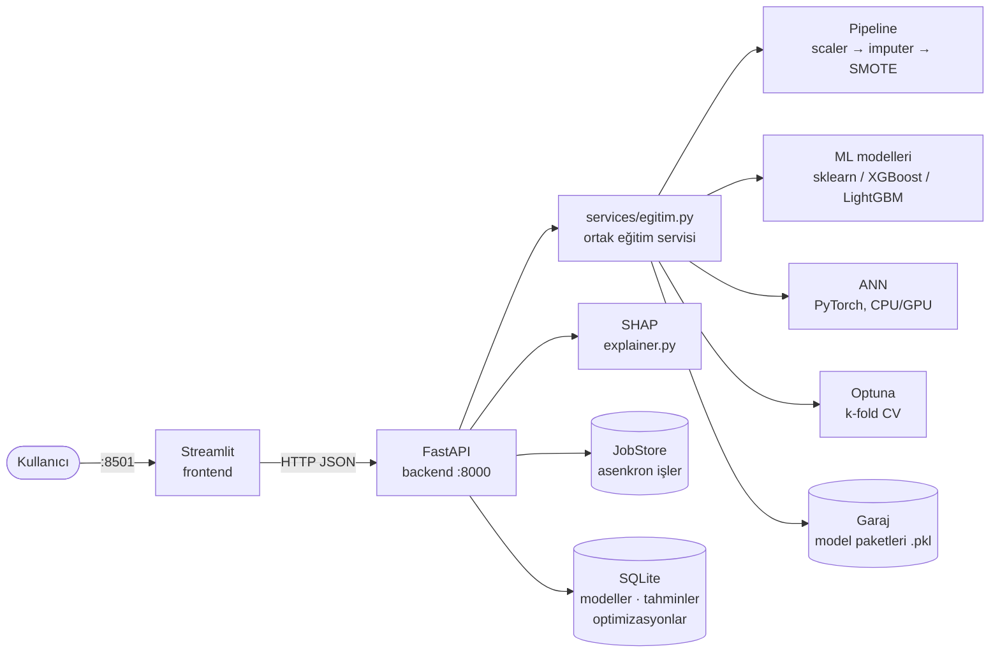

# 💧 Su Kalitesi Sınıflandırma Sistemi

Bir su örneğinin 9 kimyasal ölçümünden **içilebilir olup olmadığını** tahmin eden;
10 klasik makine öğrenmesi modeli ve bir PyTorch yapay sinir ağını aynı veri
hazırlama hattıyla eğiten, karşılaştıran, hiperparametrelerini optimize eden ve
her tahmini SHAP ile açıklayan uçtan uca bir uygulama.

- **Arayüz:** Streamlit (5 sekme: EDA → Preprocessing → ML → Derin Öğrenme → Model Garajı)
- **API:** FastAPI (eğitim, tahmin, açıklama, asenkron işler; `/docs` altında Swagger)
- **Depolama:** SQLite (model metadata, tahmin geçmişi, optimizasyon geçmişi) + model dosyaları
- **Çalıştırma:** Docker Compose; GPU isteğe bağlı

🎬 **Tanıtım videosu (2 dk):** [`docs/tanitim.mp4`](docs/tanitim.mp4) — EDA, eksik veri
testleri, Optuna, ANN (GPU), model garajı ve SHAP açıklaması uçtan uca.

---

## İçindekiler

1. [Veri seti](#veri-seti)
2. [Yöntem](#yöntem)
3. [Sonuçlar](#sonuçlar)
4. [Mimari](#mimari)
5. [Kurulum ve çalıştırma](#kurulum-ve-çalıştırma)
6. [Testler](#testler)
7. [API](#api)
8. [Dizin yapısı](#dizin-yapısı)

---

## Veri seti

[Kaggle — Water Potability](https://www.kaggle.com/datasets/adityakadiwal/water-potability)
(`data/water_potability.csv`, repoda).


|                 |                                                                                                                        |
| ----------------- | ------------------------------------------------------------------------------------------------------------------------ |
| Örnek sayısı | 3 276                                                                                                                  |
| Özellikler     | `ph`, `Hardness`, `Solids`, `Chloramines`, `Sulfate`, `Conductivity`, `Organic_carbon`, `Trihalomethanes`, `Turbidity` |
| Hedef           | `Potability` — 0: içilemez (1 998, %61), 1: içilebilir (1 278, %39)                                                 |
| Eksik değer    | `ph` 491 (%15.0), `Sulfate` 781 (%23.8), `Trihalomethanes` 162 (%4.9)                                                  |

Veri seti zor bir problemdir: özellikler ile hedef arasında güçlü doğrusal ilişki
yoktur ve sınıflar özellik uzayında büyük ölçüde örtüşür. Bu yüzden en iyi
modellerin ROC-AUC değerleri bile orta düzeydedir (bkz. [Sonuçlar](#sonuçlar)).

## Yöntem

### Veri sızıntısını önleyen sıra

1. **Önce bölme:** stratified %80 eğitim / %20 test (`random_state=42`). Test seti
   hiçbir dönüşümün `fit` aşamasına, hiperparametre aramasına ya da erken
   durdurmaya girmez.
2. **Ölçekleme → eksik değer doldurma** (`sklearn.Pipeline`, yalnızca eğitim setine
   `fit`): RobustScaler / StandardScaler / MinMaxScaler; median ya da KNN imputer.
   Ölçekleme önce gelir, böylece KNN imputer mesafeleri ölçekli uzayda hesaplanır.
3. **Sınıf dengesizliği** yalnızca eğitim setinde: SMOTE, ya da `class_weight`
   (XGBoost'ta eşdeğeri `scale_pos_weight`).
4. Eğitilen her model, kendi pipeline'ı ve preprocessing ayarlarıyla birlikte
   **tek pakette** saklanır; tahmin ve açıklama her zaman modelin eğitildiği
   dönüşümle yapılır.

### Eksik veri mekanizması

Tek bir global imputation yönteminin uygun olup olmadığı test edildi:


| Test                                                                 | Sonuç                              |
| ---------------------------------------------------------------------- | ------------------------------------- |
| Little MCAR testi (EM tahmini)                                       | χ² = 39.04, sd = 51, **p = 0.89** |
| Her eksik kolon için diğer 8 özellikte Welch t-testi (Bonferroni) | en küçük p ≈ 0.14               |
| Eksiklik göstergesi ~ Potability (χ²)                             | p = 0.16 / 0.35 / 0.20              |

Hiçbir test MCAR'ı reddetmiyor; veri **MCAR ile tutarlı**. (Bu testler MCAR'ı
kanıtlamaz, yalnızca reddedemez; MNAR gözlenen veriden test edilemez.) Testler
arayüzün EDA sekmesinde canlı hesaplanır.

### Modeller

Logistic Regression, Naive Bayes, KNN, Decision Tree, Random Forest, Gradient
Boosting, XGBoost, LightGBM, AdaBoost, SVM ve **PyTorch ANN** (katman sayısı/genişliği
ayarlanabilir, BatchNorm, Dropout, early stopping; validation seti SMOTE'tan önce
eğitim setinden stratified ayrılır, seed sabit).

### Hiperparametre optimizasyonu

Optuna (TPE). Her deneme **eğitim setinde stratified k-fold CV** ile puanlanır;
imputer, scaler ve SMOTE her fold'un içinde yeniden `fit` edilir. En iyi
parametreler test setinde yalnızca bir kez ölçülür; arayüz CV skoru ile test
skorunu yan yana gösterir.

### Değerlendirme

ROC-AUC (ana metrik), PR-AUC, F1, recall, precision, balanced accuracy,
accuracy, karışıklık matrisi. Dengesiz veri nedeniyle accuracy tek başına
yanıltıcıdır; azınlık sınıfı için PR-AUC ve recall birlikte okunmalıdır.

### Açıklanabilirlik (SHAP)

Tüm modeller **olasılık uzayında** açıklanır, böylece
`beklenen değer + Σ SHAP = modelin P(içilebilir) tahmini` olur:


| Yöntem                        | Modeller                      | Toplam – tahmin farkı                   |
| -------------------------------- | ------------------------------- | ------------------------------------------- |
| TreeExplainer (interventional) | DT, RF, GB, XGBoost, LightGBM | 0 (kesin)                                 |
| KernelExplainer                | LR, NB, KNN, SVM, AdaBoost    | 0 (verimlilik kısıtı)                  |
| GradientExplainer              | ANN                           | ≈ 0.02 (örneklemeye dayalı yaklaşık) |

Arayüz her waterfall'ın altında bu doğrulamayı gösterir.

### Girdi doğrulama

API fiziksel olarak imkânsız değerleri reddeder (pH 0–14 dışı, negatif
konsantrasyon). Eğitim aralığı dışındaki gerçek ölçümler kabul edilir, ancak
yanıtta **ekstrapolasyon uyarısı** döner (ör. `Solids=70,000 eğitim aralığı dışında`). Toplu tahminde her satır ayrı doğrulanır; hatalı satır isteği düşürmez.

## Sonuçlar

Tüm sayılar `python scripts/sonuc_tablosu.py` ile, geçici bir garaj ve
veritabanında yeniden üretilebilir (~10 dk; ham çıktı: [`docs/sonuclar.md`](docs/sonuclar.md),
[`docs/sonuclar.json`](docs/sonuclar.json)).

### Sabit bölmede (random_state = 42) test sonuçları

<!-- SONUCLAR:BASLA -->
| Model | Ayar | ROC-AUC | PR-AUC | F1 | Recall | Precision | Bal. Acc. | Accuracy | CV AUC ± std |
|---|---|---|---|---|---|---|---|---|---|
| Gradient Boosting | Optuna (20 trial) | **0.682** | 0.617 | 0.538 | 0.535 | 0.541 | 0.623 | 0.642 | 0.678 ± 0.021 |
| Random Forest | Optuna (20 trial) | **0.681** | 0.605 | 0.523 | 0.484 | 0.569 | 0.625 | 0.655 | 0.694 ± 0.017 |
| Random Forest | varsayılan | **0.675** | 0.592 | 0.524 | 0.469 | 0.594 | 0.632 | 0.668 | — |
| XGBoost | Optuna (20 trial) | **0.674** | 0.603 | 0.558 | 0.617 | 0.510 | 0.619 | 0.619 | 0.684 ± 0.012 |
| ANN (PyTorch) | varsayılan (64-32) | **0.673** | 0.603 | 0.544 | 0.562 | 0.527 | 0.620 | 0.633 | — |
| Gradient Boosting | varsayılan | **0.668** | 0.600 | 0.535 | 0.539 | 0.531 | 0.617 | 0.634 | — |
| XGBoost | varsayılan | **0.666** | 0.608 | 0.502 | 0.488 | 0.516 | 0.598 | 0.622 | — |
| LightGBM | Optuna (20 trial) | **0.664** | 0.594 | 0.515 | 0.477 | 0.560 | 0.618 | 0.649 | 0.684 ± 0.018 |
| LightGBM | varsayılan | **0.659** | 0.590 | 0.528 | 0.508 | 0.551 | 0.621 | 0.646 | — |
| SVM | varsayılan | **0.654** | 0.568 | 0.523 | 0.535 | 0.511 | 0.604 | 0.619 | — |
| SVM | Optuna (20 trial) | **0.652** | 0.571 | 0.523 | 0.551 | 0.498 | 0.598 | 0.608 | 0.701 ± 0.018 |
| AdaBoost | Optuna (20 trial) | **0.628** | 0.542 | 0.492 | 0.484 | 0.500 | 0.587 | 0.610 | 0.667 ± 0.020 |
| KNN | Optuna (20 trial) | **0.626** | 0.540 | 0.519 | 0.559 | 0.485 | 0.589 | 0.596 | 0.659 ± 0.015 |
| KNN | varsayılan | **0.617** | 0.494 | 0.477 | 0.492 | 0.463 | 0.564 | 0.579 | — |
| Naive Bayes | varsayılan | **0.609** | 0.484 | 0.454 | 0.445 | 0.463 | 0.558 | 0.582 | — |
| Naive Bayes | Optuna (20 trial) | **0.609** | 0.484 | 0.454 | 0.445 | 0.463 | 0.558 | 0.582 | 0.578 ± 0.024 |
| Decision Tree | Optuna (20 trial) | **0.601** | 0.518 | 0.402 | 0.324 | 0.529 | 0.570 | 0.624 | 0.627 ± 0.022 |
| Decision Tree | varsayılan | **0.585** | 0.441 | 0.503 | 0.519 | 0.487 | 0.585 | 0.599 | — |
| AdaBoost | varsayılan | **0.566** | 0.457 | 0.495 | 0.582 | 0.431 | 0.545 | 0.537 | — |
| Logistic Regression | Optuna (20 trial) | **0.553** | 0.470 | 0.479 | 0.555 | 0.421 | 0.534 | 0.529 | 0.473 ± 0.016 |
| Logistic Regression | varsayılan | **0.547** | 0.460 | 0.474 | 0.547 | 0.418 | 0.530 | 0.526 | — |

*Üretim: `python scripts/sonuc_tablosu.py` — 2026-11-04. Test seti: %20 stratified (n=656), random_state=42; median imputer, RobustScaler, SMOTE yalnızca eğitim setinde. Test metrikleri tek seferlik; CV AUC Optuna aramasının eğitim setindeki 5-fold ortalamasıdır (test seti aramaya girmez). Sıralama test ROC-AUC'ye göre.*

### Bölme değişkenliği (varsayılan parametreler, 10 farklı stratified bölme)

| Model | Test ROC-AUC ort ± std | min – max |
|---|---|---|
| SVM | **0.683** ± 0.016 | 0.659 – 0.706 |
| Random Forest | **0.680** ± 0.020 | 0.655 – 0.711 |
| XGBoost | **0.669** ± 0.022 | 0.641 – 0.718 |
| LightGBM | **0.658** ± 0.019 | 0.624 – 0.689 |
| Gradient Boosting | **0.645** ± 0.020 | 0.615 – 0.677 |
| KNN | **0.617** ± 0.021 | 0.594 – 0.666 |
| Decision Tree | **0.580** ± 0.017 | 0.548 – 0.605 |
| Naive Bayes | **0.577** ± 0.027 | 0.539 – 0.639 |
| AdaBoost | **0.557** ± 0.021 | 0.529 – 0.596 |
| Logistic Regression | **0.497** ± 0.013 | 0.478 – 0.521 |

*Her bölmede aynı preprocessing (median, RobustScaler, SMOTE yalnızca eğitimde), random_state 0…9. ANN bu tabloda yok (GPU/epoch süresi).*
<!-- SONUCLAR:BITIR -->

### Yorum

- **En iyi grup** ağaç tabanlı topluluklar (Random Forest, XGBoost, LightGBM,
  Gradient Boosting), RBF çekirdekli SVM ve ANN'dir; test ROC-AUC 0.65–0.68
  bandındadır. Tek bölmede Gradient Boosting birinci görünse de 10 farklı
  bölmenin ortalamasında sıralama değişir (SVM 0.683 ± 0.016, Random Forest
  0.680 ± 0.020). Bölmeler arası standart sapma ≈ 0.02 olduğundan **bu grubun
  içindeki farklar istatistiksel olarak anlamlı değildir**; tek bir "en iyi
  model" iddiası yerine "en iyi model ailesi" demek doğrudur.
- **Optuna'nın kazancı küçüktür** (çoğu modelde test AUC'de ≤ 0.015). Belirgin
  kazanç yalnızca varsayılanı zayıf olan modellerde görülür: AdaBoost 0.566 →
  0.628, Decision Tree 0.585 → 0.601. SVM'de CV skoru (0.701) test skorundan
  (0.652) yüksektir: çok sayıda deneme arasından en iyisini seçmek CV skorunu
  iyimser yapar; bu yüzden test seti aramaya hiç sokulmaz ve ayrı raporlanır.
- **Logistic Regression rastgele tahmin düzeyindedir** (10 bölmede 0.497 ±
  0.013): özellikler ile hedef arasında doğrusal bir ilişki yoktur. Sabit
  bölmedeki 0.553 (test) ve 0.473 (CV) aynı gürültünün iki yüzüdür; sinyal
  sıfıra yakın olduğunda bir bölmenin eğitim ve test yarıları birbirinin ters
  yönüne sapar. Doğrusal olmayan modellerin üstünlüğü bu veri setinin temel
  bulgusudur.
- **Pratik anlam:** en iyi modellerde precision ≈ 0.55, recall ≈ 0.5. İçme
  suyu güvenliği açısından kritik hata, içilemez suya "içilebilir" demektir
  (yanlış pozitif). Arayüzdeki **karar eşiği** yükseltilerek precision artırılabilir
  (recall pahasına); bu veri setiyle model tek başına bir güvenlik kararı
  vermek için yeterli değildir, bir ön eleme aracı olarak düşünülmelidir.

## Mimari



- Senkron uçlar (`/train/ml/{model}`) ve asenkron uçlar (`/train/ml/async/{model}`)
  aynı servis fonksiyonunu çağırır; asenkron işler `/jobs/{id}` ile izlenir ve
  arayüz sayfayı kilitlemeden ilerlemeyi gösterir.
- Beklenmeyen sunucu hatalarında istemciye yalnızca bir hata kimliği döner;
  ayrıntı `docker compose logs backend` içindedir.

## Kurulum ve çalıştırma

Gereksinim: **Docker Desktop** (Windows/macOS; Windows'ta WSL2 backend) ya da
Linux'ta Docker Engine 24+ ve Docker Compose v2. Python kurmana gerek yok.

```bash
git clone https://github.com/MereTonga/bitirme_projesi.git
cd bitirme_projesi
```

Sonra makinene uyan **tek satırı** çalıştır:

| Makinen | Komut | İlk kurulum |
|---|---|---|
| **NVIDIA ekran kartı yok** (ya da emin değilsin) | `docker compose up --build` | ~3.6 GB indirme |
| **NVIDIA ekran kartı var** | `docker compose -f docker-compose.yml -f docker-compose.gpu.yml up --build` | ~10 GB indirme (CUDA) |

İlk çalıştırma indirme nedeniyle birkaç dakika sürer; sonrakiler saniyeler.
Terminalde backend ve frontend logları akmaya başlayınca:

- **Arayüz:** <http://localhost:8501>
- **API dokümantasyonu:** <http://localhost:8000/docs>

Arayüzün sağ üst köşesi hangi donanımda çalıştığını gösterir: `🎮 <GPU adı>` ya
da `💻 CPU`. Garaj (eğitilmiş modeller) boş başlar; modeller arayüzden eğitilir.

> **GPU komutu hata verirse** (`could not select device driver "nvidia"`):
> Docker GPU'yu göremiyor demektir. Windows'ta güncel NVIDIA sürücüsü + Docker
> Desktop (WSL2) yeterlidir; Linux'ta ayrıca
> [NVIDIA Container Toolkit](https://docs.nvidia.com/datacenter/cloud-native/container-toolkit/latest/install-guide.html)
> gerekir. Kontrol: `docker run --rm --gpus all ubuntu nvidia-smi` ekran
> kartını listelemeli. Olmuyorsa CPU komutunu kullan: her şey çalışır, yalnızca
> ANN eğitimi daha yavaştır (bu veri setinde birkaç saniye fark).

### Durdurma, yeniden başlatma, sıfırlama

| İstediğin | Komut |
|---|---|
| Arka planda başlat (terminali bırak) | komutun sonuna ` -d` ekle |
| Durdur (modeller ve veritabanı kalır) | `docker compose down` |
| Tekrar başlat | aynı `up` komutu (`--build` yalnızca kod/bağımlılık değişince gerekir) |
| Logları gör | `docker compose logs -f backend` |
| **Her şeyi sıfırla** (modeller ve tahmin geçmişi silinir) | `docker compose down -v` |

GPU kullanıyorsan `down` komutlarında da aynı `-f ... -f ...` kısmını yaz
(ya da aşağıdaki `.env` yöntemini kullan).

### Ne nerede çalışıyor?

İki container vardır: **backend** (FastAPI + modeller, port 8000) ve
**frontend** (Streamlit, port 8501). Eğitilmiş modeller ve veritabanı Docker'ın
yönettiği iki kalıcı alanda (`su_kalitesi_garage`, `su_kalitesi_db`) tutulur;
container'lar silinip yeniden oluşturulsa da kaybolmaz, yalnızca `down -v`
siler. Container'lar root olmayan bir kullanıcıyla ve İstanbul saatiyle çalışır.

Compose dosyaları katman gibi üst üste eklenir:

| Dosya | Ne ekler |
|---|---|
| `docker-compose.yml` | Temel kurulum: CPU, her makinede çalışır |
| `docker-compose.gpu.yml` | PyTorch'un CUDA sürümü + ekran kartı erişimi |
| `docker-compose.dev.yml` | Geliştirme: kod değişiklikleri anında yansır, modeller ve veritabanı proje klasöründe (`./backend/garage`, `./database`) görünür |

### Projede geliştirme yapıyorsan

Uzun komutları her seferinde yazmamak için hangi katmanların kullanılacağını
bir kez `.env` dosyasına yaz (git'e girmez):

```bash
cp .env.example .env     # varsayılan içerik: temel + GPU + geliştirme
                         # GPU yoksa .env'deki COMPOSE_FILE satırından
                         # ":docker-compose.gpu.yml" kısmını sil
docker compose up -d --build
```

Bundan sonra her yerde kısa komutlar yeterli: `docker compose up -d`,
`docker compose down`, `docker compose logs -f backend`. Kod değişikliği
için yeniden build gerekmez (backend ve frontend kendini yeniler); yalnızca
`requirements.txt` ya da `Dockerfile` değişince `--build` ekle.

### Docker olmadan

Python 3.11:

```bash
pip install --index-url https://download.pytorch.org/whl/cpu torch==2.9.1
pip install -r backend/requirements.txt -r frontend/requirements.txt

cd backend && uvicorn main:app --port 8000          # 1. terminal
streamlit run frontend/app.py                        # 2. terminal (proje kökünden)
```

## Testler

```bash
pip install -r requirements-dev.txt
pytest                      # 68 birim + API + arayüz testi (~20 sn, geçici garaj/DB)
pytest -m integration       # çalışan docker compose kurulumuna karşı uçtan uca
```

Kapsam: veri hazırlama sırası ve sızıntı kontrolleri, her model ailesi için
eğitim/tahmin/SHAP tutarlılığı (`beklenen + Σ SHAP = tahmin`), Optuna CV,
eksiklik testleri (sentetik MCAR/MAR verisinde doğru karar), girdi doğrulama,
veritabanı sorguları, hata mesajlarında iç ayrıntı sızmaması ve Streamlit
arayüzünün başsız (`AppTest`) duman testleri.

## API

Tam şema ve deneme arayüzü: [http://localhost:8000/docs](http://localhost:8000/docs)


| Grup         | Uçlar                                                                                                                                                                                       |
| -------------- | ---------------------------------------------------------------------------------------------------------------------------------------------------------------------------------------------- |
| Eğitim      | `POST /train/ml/{model}` · `POST /train/dl/ann`                                                                                                                                             |
| Asenkron     | `POST /train/ml/async/{model}` · `POST /train/dl/async` · `POST /optimize/async` · `GET /jobs` · `GET /jobs/{id}`                                                                        |
| Optimizasyon | `POST /optimize` · `GET /optimize/gecmis`                                                                                                                                                   |
| Tahmin       | `POST /predict` · `POST /predict/batch` (≤ 1000 satır)                                                                                                                                    |
| Açıklama   | `POST /explain` · `POST /explain/summary`                                                                                                                                                   |
| Garaj        | `GET /models` · `GET /models/karsilastir` · `GET /models/{dosya}` · `GET /models/{dosya}/gecmis` · `DELETE /models/{dosya}`                                                              |
| Veritabanı  | `GET /db/modeller` · `GET /db/tahminler` · `GET /db/tahmin-istatistik` · `GET /db/gunluk-dagilim` · `GET /db/model-istatistik` · `GET /db/istatistik` · `PUT /db/modeller/{dosya}/not` |
| Sağlık     | `GET /` · `GET /health`                                                                                                                                                                     |

`{model}`: `logistic_regression`, `naive_bayes`, `knn`, `decision_tree`,
`random_forest`, `gradient_boosting`, `xgboost`, `lightgbm`, `adaboost`, `svm`.

## Dizin yapısı

```
├── backend/
│   ├── main.py               FastAPI uygulaması, lifespan, hata yönetimi
│   ├── config.py             yollar ve sabitler (env ile değiştirilebilir)
│   ├── routers/              ince HTTP katmanı
│   ├── services/egitim.py    ML / ANN / Optuna eğitim akışı (tek yer)
│   ├── pipeline_builder.py   split → scaler → imputer → SMOTE
│   ├── preprocessor.py       eksik veri analizi ve testleri (Little, Welch, χ²)
│   ├── optimizer.py          Optuna + stratified k-fold CV
│   ├── explainer.py          SHAP (Tree / Kernel / Gradient)
│   ├── girdi_kontrol.py      eğitim aralığı ve ekstrapolasyon uyarıları
│   ├── ml/  dl/              model sınıfları, PyTorch ANN ve eğitim döngüsü
│   ├── database/             SQLite şema, migration ve sorgular
│   └── garage_manager.py     model paketlerini kaydet / yükle / sil
├── frontend/
│   ├── app.py                Streamlit giriş noktası
│   ├── api_client.py         backend istemcisi
│   ├── ui_ortak.py           ortak bileşenler
│   └── sekmeler/             EDA, preprocessing, ML, DL, garaj, iş takibi, SHAP grafikleri
├── tests/                    pytest (birim, API, arayüz) + integration/
├── scripts/sonuc_tablosu.py  README sonuç tablosunu üretir
├── scripts/demo_video.sh     tanıtım videosunu otomatik kaydeder (izole kopya, Playwright)
├── docs/sonuclar.md          üretilmiş sonuç tablosu (+ .json)
├── docs/tanitim.mp4          tanıtım videosu
├── data/water_potability.csv
├── docker-compose.yml        temel (CPU)
├── docker-compose.gpu.yml    GPU eki
└── docker-compose.dev.yml    geliştirme eki
```
